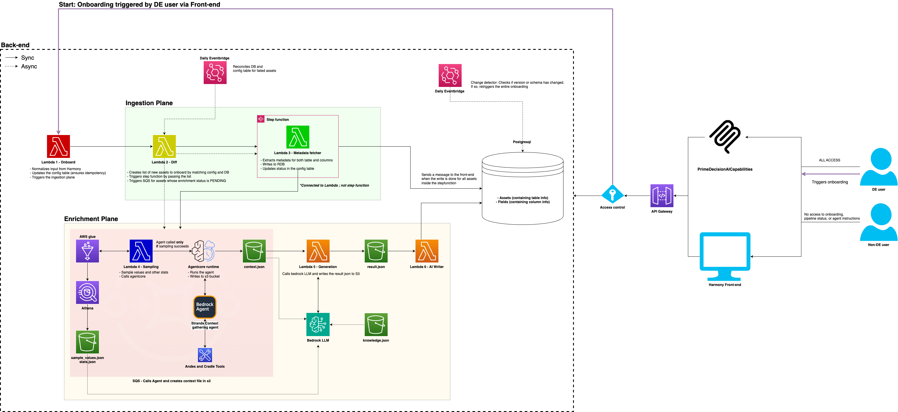

# Metadata Platform & AI-Powered Data Catalog

An end-to-end metadata platform I built during my Amazon internship to help engineers discover datasets, understand schemas, trace dependencies, and answer data questions through a catalog interface and an AI assistant.

The project combines distributed metadata ingestion, hybrid search, recursive lineage, and tool-based AI access. It brings metadata from different data systems into a consistent catalog and makes that context available through both a browsing interface and natural-language workflows.

**[Watch the product demo](./Project%20demo.mp4)** · **[View the architecture](./HLD.png)**

> This repository is a public project showcase containing a high-level architecture diagram and a selectively redacted demonstration. Production source code, internal configurations, and underlying datasets are not included.

## Project at a glance

| Area | Scope and outcome |
| --- | --- |
| Metadata ingestion | Normalized metadata for **1,000+ datasets** and **50,000+ columns** across MySQL and S3 data systems |
| Catalog synchronization | PySpark pipelines with incremental change detection to keep catalog state synchronized |
| Storage and retrieval | PostgreSQL, pgvector, and object storage, with keyword and semantic retrieval |
| Search relevance | **15% improvement in top-5 dataset search relevance** using field-level ranking and reciprocal-rank fusion |
| Lineage | Recursive dataset- and column-level dependency tracing |
| AI integration | AWS Strands agent on Amazon Bedrock AgentCore and an MCP server exposing **5 tools across 10 APIs** |
| Token efficiency | **10% reduction in token usage** |

These figures summarize the project's scale and reported outcomes. The demo illustrates the product workflows; it is not a benchmark reproduction.

## The problem

Finding a dataset is only the first step in using it. Engineers also need to understand what its columns mean, how it was produced, whether it is suitable for their use case, and what depends on it.

When this context is spread across data systems, SQL, transformation jobs, and separate metadata services, answering those questions requires repeated manual investigation. Similar dataset names can also hide important differences in schema, data types, quality, and intended use.

I built the platform to bring discovery, schema exploration, lineage, and metadata-grounded assistance into one workflow.

## What I built

### 1. Metadata ingestion and synchronization

I built PySpark pipelines to ingest and normalize metadata for more than 1,000 datasets and 50,000 columns across MySQL and S3 data systems.

The ingestion layer brings source-specific metadata into a consistent catalog representation so datasets and columns can be searched and inspected through the same interface. Incremental change detection keeps catalog state synchronized as source metadata changes.

This provides the foundation for the rest of the platform: search, schema exploration, lineage, and AI responses all depend on a shared metadata layer.

### 2. Storage, serving, and hybrid search

I designed the storage and serving layer across PostgreSQL, pgvector, and object storage. The retrieval workflow combines keyword and semantic search so users can search with either familiar dataset terminology or a description of what they need.

The search design combines three techniques:

- **Keyword and semantic retrieval:** supports both direct term matches and conceptually related results.
- **Field-level ranking:** considers where a match occurs within dataset and column metadata.
- **Reciprocal-rank fusion:** combines ranked retrieval results into a unified ordering.

Together, these changes improved top-5 dataset search relevance by **15%**.

The catalog interface supports browsing and filtering datasets, inspecting dataset details, exploring schemas, and reviewing sample values and metadata descriptions.

### 3. Recursive dataset and column lineage

I built recursive lineage by traversing upstream SQL, downstream transformation jobs, and internal lineage systems.

The lineage functionality operates at two levels:

- **Dataset lineage:** traces relationships between source datasets, transformations, and downstream datasets.
- **Column lineage:** traces dependencies at the field level to help explain how individual columns are derived.

This enables engineers to investigate where data came from, assess downstream impact before making changes, and trace dependencies while debugging data-quality issues.

### 4. Metadata-grounded AI assistance

I developed an AWS Strands agent on Amazon Bedrock AgentCore and an MCP server exposing **5 tools across 10 APIs**. The integration gives AI workflows structured access to catalog data, lineage, and quality signals.

In the demo, Kiro acts as an MCP client. The visible workflow shows the assistant selecting tools, retrieving catalog information, and using the returned context to answer the user's question. Tool calls remain visible so viewers can follow how the assistant obtains its evidence.

Examples of tool operations shown in the recording include:

- `list_datasets` — discover candidate datasets.
- `get_dataset_detail` — retrieve metadata for a selected dataset.
- `get_dataset_sample` — retrieve sample information for further inspection.

These are examples visible in the demo, rather than the complete five-tool inventory. The broader integration grounds responses in catalog, lineage, and quality context and reduced token usage by **10%**.

## Demo walkthrough

The [redacted product demo](./Project%20demo.mp4) follows the workflow from browsing metadata to asking questions about it.

### Browse the catalog and inspect a schema

The catalog lists datasets with source/provider labels and filtering controls. Opening a dataset exposes its details and schema, including column names, data types, source descriptions, AI-generated descriptions, and sample-value fields.

The interface keeps source descriptions and AI-generated descriptions separate, making their origins visible to the user.

### Find a dataset through a natural-language question

The user asks which dataset could help answer a customer-payment-related question. The assistant calls catalog tools and returns a candidate dataset with an explanation and a table of relevant fields.

This demonstrates the connection between retrieval and practical dataset selection: the user can move from a business question to concrete schema information.

### Investigate null values and quality caveats

A follow-up question asks whether there are null values to be concerned about. The assistant retrieves sample information and presents findings about nulls, missing rows, and freshness.

The workflow illustrates why quality interpretation requires context. Observed samples, schema nullability, missing records, and freshness describe different aspects of a dataset; a clean sample alone does not establish that every record is complete or current.

### Compare datasets across systems

The final workflow asks the assistant to compare a catalog-backed dataset with an S3 counterpart. It retrieves metadata for the datasets and presents a comparison table, followed by practical implications and caveats.

This shows how the platform can support decisions about dataset suitability by bringing schema and metadata differences into a single response.

Sensitive descriptions, identifiers, URLs, record-level values, and detailed internal content are obscured in the recording. Questions, tool calls, navigation, schema headers, and selected examples remain visible to demonstrate functionality.

## High-level architecture

At a conceptual level, the platform connects four parts:

1. **Ingestion and normalization:** PySpark pipelines collect source metadata and detect changes.
2. **Storage and serving:** PostgreSQL, pgvector, and object storage support catalog access and retrieval.
3. **Discovery and context:** hybrid search and recursive lineage help users locate and understand datasets.
4. **User-facing access:** the catalog UI, AWS Strands agent, and MCP integration make that context available through browsing and natural-language workflows.

## Technology stack

| Layer | Technologies and techniques |
| --- | --- |
| Source systems | MySQL, Amazon S3 |
| Metadata processing | PySpark, incremental change detection |
| Storage and serving | PostgreSQL, pgvector, object storage |
| Retrieval | Keyword search, semantic search, field-level ranking, reciprocal-rank fusion |
| Dependency tracing | SQL traversal, transformation-job traversal, dataset and column lineage |
| AI integration | AWS Strands, Amazon Bedrock AgentCore, Model Context Protocol (MCP) |
| Demo client | Kiro |

## Repository contents

| File | Description |
| --- | --- |
| [HLD.png](./HLD.png) | High-level architecture diagram |
| [Project demo.mp4](./Project%20demo.mp4) | Selectively redacted product demonstration |
| [README.md](./README.md) | Project overview, technical contributions, and demo guide |

This repository documents the project and its demonstrated behavior. It does not include a locally runnable implementation or deployment instructions.
